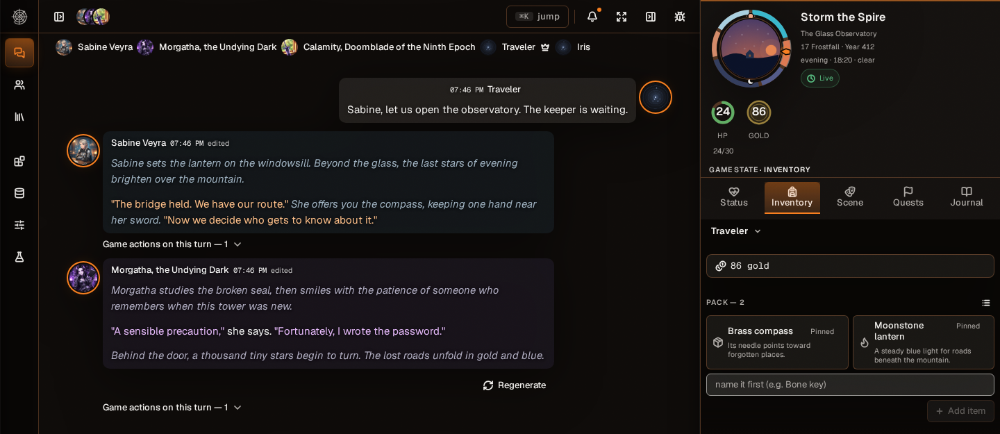
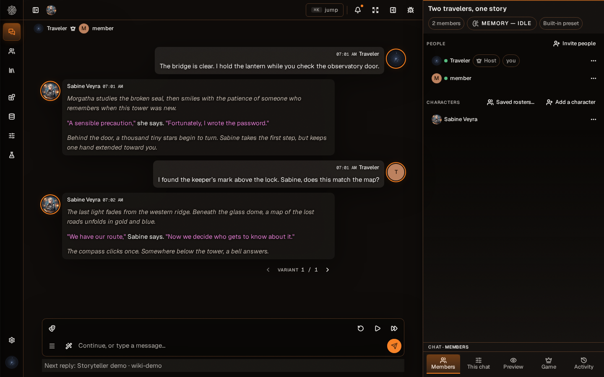
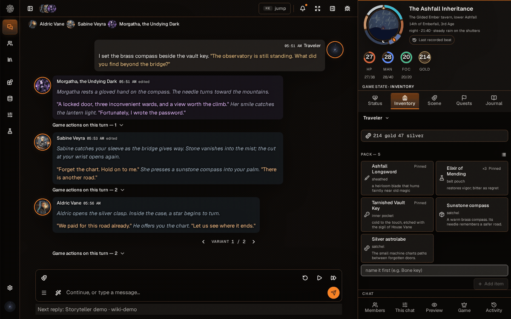
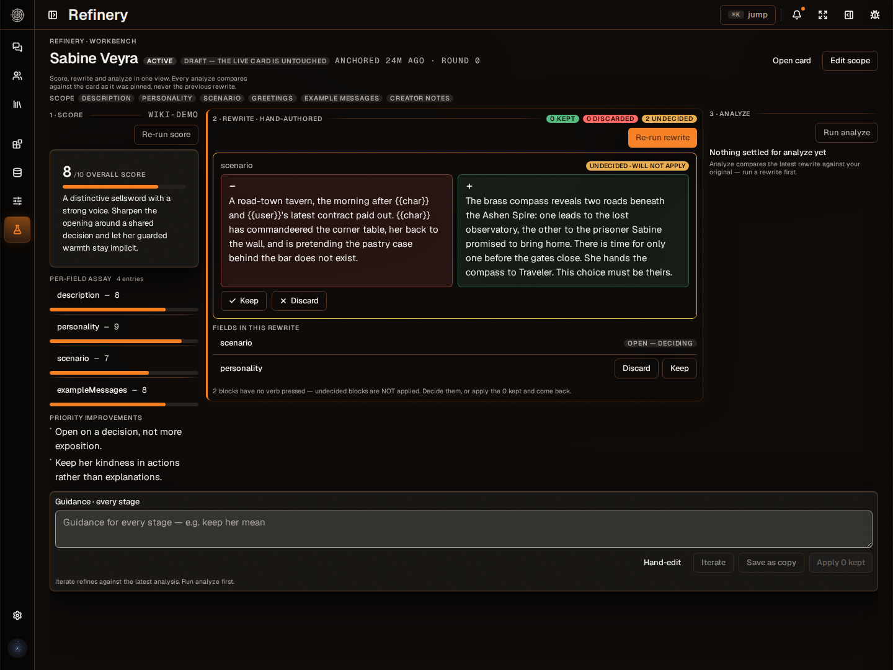
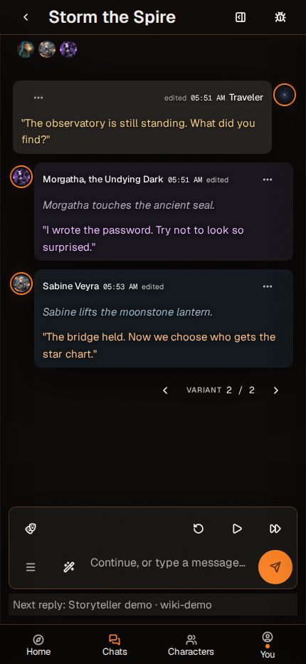

<p align="center"></p>

<h1 align="center">Orbweaver</h1>

<p align="center"><strong>Roleplay with your friends in the same scene, live.</strong></p>

<p align="center">
  <a href="https://github.com/Inktomi93/OrbWeaver/wiki/Install">Install</a> ·
  <a href="https://github.com/Inktomi93/OrbWeaver/wiki/Connect-a-Model">Connect a model</a> ·
  <a href="https://github.com/Inktomi93/OrbWeaver/wiki/Your-First-Chat">Your first chat</a> ·
  <a href="https://github.com/Inktomi93/OrbWeaver/wiki/Coming-from-SillyTavern">Coming from SillyTavern</a> ·
  <a href="https://github.com/Inktomi93/OrbWeaver/wiki">The whole guide</a>
</p>



Orbweaver is a self-hosted AI roleplay app with real-time multiplayer: several people and several characters
in one live scene. Invite friends in, turn any story into a game, and keep chats that remember what happened
a hundred messages ago. Your SillyTavern library comes over in one step. It runs on your own machine, and your
characters, chats and keys stay there.

One dude built this, and it's an alpha: there are rough edges, and a few SillyTavern features aren't here yet
([the exact list](https://github.com/Inktomi93/OrbWeaver/wiki/Coming-from-SillyTavern#what-isnt-supported)).
It's also a love letter to SillyTavern. The shared rooms started with STMP (SillyTavern MultiPlayer) by
RossAscends, and I wanted that in every scene. ([Credits](https://github.com/Inktomi93/OrbWeaver/wiki/Credits))

| You are... | Start here |
| - | - |
| New to AI roleplay | [Install](https://github.com/Inktomi93/OrbWeaver/wiki/Install) → [Connect a model](https://github.com/Inktomi93/OrbWeaver/wiki/Connect-a-Model) → [Your first chat](https://github.com/Inktomi93/OrbWeaver/wiki/Your-First-Chat) |
| Coming from SillyTavern | [Install](https://github.com/Inktomi93/OrbWeaver/wiki/Install) → [Coming from SillyTavern](https://github.com/Inktomi93/OrbWeaver/wiki/Coming-from-SillyTavern) |
| Hosting for friends | [Install](https://github.com/Inktomi93/OrbWeaver/wiki/Install) → [Share with friends](https://github.com/Inktomi93/OrbWeaver/wiki/Share-with-Friends) |

## Play together

Invite friends into your scene and play it together. You see who's online, everyone takes their turns, and the
characters answer all of you. React to each other's messages and let the characters react too. Hand the room to
someone else when you're done hosting, or let the characters talk among themselves for a few rounds while you
watch. Every device you sign in on stays live, so a scene started on your computer carries on from your phone.

You don't need to know networking to get friends in: choose "me and friends" at setup, press Start sharing, and
send them the link. ([Rooms and group chats](https://github.com/Inktomi93/OrbWeaver/wiki/Rooms-and-Group-Chats),
[Share with friends](https://github.com/Inktomi93/OrbWeaver/wiki/Share-with-Friends))



## Turn any story into a game

Flip one switch and your chat becomes a light RPG. You keep writing the story the way you always do, and the
game keeps track of it beside you: stats you define, relationships, quests, inventory, coin and a journal, with
a band across the top of the panel for the place, the date, the time of day and the weather. Games start
story-driven; switch on the D20 rules any time for attributes, health and dice.

Every swipe keeps its own state. Swipe to another version of a reply and the whole game swaps with it: stats,
loot, quests, who's in the scene. Reroll a bad turn and the damage goes with it.
([RPG mode](https://github.com/Inktomi93/OrbWeaver/wiki/RPG-Mode))



## Stories that remember

Long chats don't forget. Every few messages Orbweaver writes a short summary, and older summaries roll up into
broader ones, so the story so far stays compact however long the chat runs. When an old moment becomes relevant
again, it's found by meaning and by keyword and brought back into the scene. In a group chat each character can
keep their own memory and recall only what happened while they were in the room. You can search your own past
scenes the same way: describe the moment and it finds the chat.
([How memory works](https://github.com/Inktomi93/OrbWeaver/wiki/How-Memory-Works))

## Your library, and a card doctor

See hundreds of cards as a map of similar characters, find the ones you never played, and search by vibe
instead of by name. The Refinery scores a card field by field and rewrites only the parts you pick; every
accepted change is a version you can roll back to, and nothing changes until you accept it. Your own stats come
with it, and every number says whether it was measured, estimated or never recorded.
([Refinery](https://github.com/Inktomi93/OrbWeaver/wiki/Refinery),
[Stats and insights](https://github.com/Inktomi93/OrbWeaver/wiki/Stats-and-Insights))



## And the rest



- **Coming from SillyTavern.** One import brings your characters, chats, personas, presets, lorebooks and
  themes. It only adds, and it reports anything it skipped.
  ([Coming from SillyTavern](https://github.com/Inktomi93/OrbWeaver/wiki/Coming-from-SillyTavern))
- **Make it look like your story.** Read a chat as bubbles, a manuscript or a visual novel with tall portraits.
  Pick a theme or build one, set a backdrop, and let a character carry their own look.
  ([Themes](https://github.com/Inktomi93/OrbWeaver/wiki/Themes))
- **Stories you can touch.** Characters can hand you a sealed letter, a wanted poster or a terminal you can
  click through, drawn inside the story in a sandbox and kept in a journal.
- **Plugins.** Sandboxed plugins that show what they want before they run, with example plugins to switch on
  and two starter repositories for your own. ([Plugins](https://github.com/Inktomi93/OrbWeaver/wiki/Plugins))
- **Automation.** Ready-made rules such as a welcome-back recap, a pacing nudge or a scene illustration, and an
  editor for your own. A rule that would write something asks first.
  ([Automation](https://github.com/Inktomi93/OrbWeaver/wiki/Automation))
- **See what was sent.** Preview what the next turn will contain and what each part costs in tokens; every
  reply keeps the prompt it was made from.
  ([How a turn is built](https://github.com/Inktomi93/OrbWeaver/wiki/How-a-Turn-Is-Built))
- **On your phone.** A one-pane layout you can add to your home screen, live and in sync with your computer.
- **Everything you'd expect.** Swipes, alternate greetings, group chats, personas, lorebooks, presets with a
  prompt manager, regex scripts, images, and chat import and export.
  ([The full list](https://github.com/Inktomi93/OrbWeaver/wiki/Features))

<br clear="right">

Orbweaver ships no language model. Paste an API key (OpenRouter, Anthropic, OpenAI, Google Gemini and others)
or point it at a model server you already run, such as Ollama, KoboldCpp, LM Studio or vLLM.
([Connect a model](https://github.com/Inktomi93/OrbWeaver/wiki/Connect-a-Model))

There's no text-completion mode, so text-completion presets don't come over.

## Run it

Pick one path. Each serves the app at <http://localhost:8788> and runs the stable release: the `release` branch
and the matching image. `main` is where development happens.

### One-line install

Linux and macOS:

```bash
curl -fsSL https://raw.githubusercontent.com/Inktomi93/OrbWeaver/release/install.sh | bash
```

Windows: download [`install.cmd`](https://raw.githubusercontent.com/Inktomi93/OrbWeaver/release/install.cmd) and
double-click it. It installs Git and pnpm with winget if they're missing.

Both clone the stable release, ask whether to run it from source or with Docker, and start it. Afterwards,
`start.sh` / `start.cmd` runs it and `update.sh` / `update.cmd` updates it. The update waits for a running
server to stop cleanly in its own window before it pulls, so nothing is cut off mid-write. The manual steps
below do the same things by hand.

### Docker (Linux, macOS, Windows)

```bash
git clone https://github.com/Inktomi93/OrbWeaver.git
cd OrbWeaver
docker compose up -d
```

Windows PowerShell:

```powershell
git clone https://github.com/Inktomi93/OrbWeaver.git
cd OrbWeaver
docker compose up -d
```

Open <http://localhost:8788>. There is no login: the port is published on this machine only, and you are the owner. Compose pulls the published release image, so there is no build step; [`docker/README.md`](docker/README.md) shows how to build from the checkout instead. The app starts its plugin watchdog and isolated broker as child processes inside the container. [`docker/README.md`](docker/README.md) also covers updates, login modes, LAN and HTTPS, tunnels, secrets and backups.

### From source

Install Git, then pnpm. pnpm fetches the Node version this repo pins by itself, so there is no Node to install:

```bash
curl -fsSL https://get.pnpm.io/install.sh | sh -    # Linux, macOS
```

```powershell
Invoke-WebRequest https://get.pnpm.io/install.ps1 -UseBasicParsing | Invoke-Expression    # Windows PowerShell
```

If Windows Defender blocks the pnpm binary, run `winget install -e --id pnpm.pnpm` instead. Then, on every platform:

```bash
git clone https://github.com/Inktomi93/OrbWeaver.git
cd OrbWeaver
pnpm install
pnpm start
```

To update, run `./update.sh` (`update.cmd` on Windows), or stop the app and run `git pull`, `pnpm install` and
`pnpm start` again.

The first `pnpm start` in a terminal asks for the port and who uses the app, and saves the answers in `.env`. It builds the client bundle when needed, runs the server in this terminal, and opens the app in your default browser once the server answers. Set `OPEN_BROWSER=off` in `.env` to keep the browser closed. Ctrl-C stops the server. With no terminal (a service, CI, piped input) it asks nothing, opens nothing and starts on the defaults. Over SSH it opens no browser. `pnpm start --port 9000` uses another port for one run.

On Windows, double-click `start.cmd` in the checkout after `pnpm install`. It runs `pnpm start` in its own console window and keeps the window open when the start fails, so you can read why. In a terminal, use PowerShell or Windows Terminal: under Git Bash's own terminal node sees no TTY, so setup asks nothing. `.github/workflows/install.yml` runs these steps on fresh Linux, macOS and Windows runners, and the Docker steps on Linux, and waits for the server to answer. Native starts on every platform run plugins in a separate bounded broker below an RSS and heartbeat watchdog; the plugin broker's macOS and Windows boots are not yet verified on real hardware.

### Who can sign in

| Choice | How | What happens |
| - | - | - |
| Just me (default) | nothing | No login. The server listens on this machine only, and you are the owner. |
| Me and friends | `pnpm start --setup`, then "me and friends" | Password login on every interface. The first visit from this machine sets the owner's password. Setup prints the addresses to open, and the step that invites friends from outside your network. |
| Single sign-on | `AUTH_MODE=oidc` or `AUTH_MODE=forward-header` in `.env` | "Login modes" in [`docker/README.md`](docker/README.md) lists the keys. Leave `AUTH_FALLBACK` and `AUTH_FALLBACK_TRUSTED_PEERS` out of `.env`: the app refuses them there and resolves them from the mode. |

In Docker, a login mode takes three lines, because the shipped defaults grant the no-login owner: `AUTH_MODE` (`local`, `oidc` or `forward-header`), `AUTH_FALLBACK=deny` and an empty `AUTH_FALLBACK_TRUSTED_PEERS=`. Put them in `docker/orbweaver.local.env` and run `docker compose up -d`. A key in any compose `environment:` block wins over that file, including the `docker/compose.host-network.yaml` overlay, which sets single-user and the owner fallback; remove those lines there, or start without that overlay. Settings > Admin > Multi-user, under Who can sign in, shows the lines for each mode with a copy button. The first `local` boot generates the password and keeps it out of the log; read it with `docker compose exec orbweaver cat /app/data/secrets/initial_password`.

A device on your network signs in over plain http, so the password and the session cookie travel in clear; the login screen says so. Put HTTPS in front when you can. An IP address and `http://<this machine>.local:8788` work as is; add any other name to `ALLOWED_HOSTS` in `.env`. Under WSL2, turn on mirrored networking (`networkingMode=mirrored` in `.wslconfig`, Windows 11) so other devices reach the app.

### Share over the internet

- `pnpm share` runs one launch with a password login and a public link, which the log prints. The server downloads a pinned `cloudflared` on the first share. `.env` is not changed.
- After "me and friends", sign in as the owner and press Start sharing in Settings → Admin → Multi-user. It downloads the same pinned `cloudflared` into `data/cache/relay/` and gives you a public link to send. Docker never asks the setup questions: set the three login lines above, then press Start sharing the same way.
- For a lasting address, run a tunnel: `tailscale serve --bg 8788`, or `cloudflared tunnel run --token <token>` with a public hostname whose service is `http://localhost:8788`. The recipes are in [`docker/README.md`](docker/README.md).
- Never forward a router port. Never put a proxy or tunnel in front of "just me": a relayed request is never the owner, so it answers 401.

### Back up your data

Everything the app keeps is in `data/`, or wherever `DATA_DIR` points. Stop the app, copy `data/` except `data/cache/`, and start it again. `data/secrets/` holds `credentials_key` (it decrypts saved provider keys) and `session_secret` (the pepper for passwords and sign-ins); a database restored without them cannot read its keys or sign anyone in, and boot refuses and names the file. Before a boot applies new migrations, it copies the database to `data/backups/`. Migrations only go forward: to roll back, stop the app, put a backup in place of `data/db/orbweaver.db`, delete the `-wal` and `-shm` files beside it, and start the older checkout.

## Author a plugin

Use the [server plugin starter](https://github.com/Inktomi93/OrbWeaver-plugin-template) or the
[visual plugin starter](https://github.com/Inktomi93/OrbWeaver-plugin-template-scripted-ui).
The visual starter separates scripted house UI from its custom-frame example.
Both consume the [versioned SDK and toolchain releases](https://github.com/Inktomi93/OrbWeaver/releases?q=plugin-authoring\&expanded=true) and move to each new one on their own.
Their guides explain builds, consent, updates, and runtime boundaries.
The application installs committed JavaScript from Git, not the author's source or build scripts.

## Work on the code

Everything below is for contributors. Orbweaver's code is written mostly by AI agents, so its architecture is
enforced by the toolchain rather than documented. Development happens on `main`: after cloning, run
`git switch main`.

`pnpm dev` runs the watched server and the Vite client from source on Linux, macOS and Windows; open <http://localhost:5173>. The server restarts on a source change, and Ctrl-C stops both. `pnpm stack up` runs the same dev stack detached, and `pnpm stack down` stops it. See [CONTRIBUTING.md](CONTRIBUTING.md) for checks and native platform evidence.

## Read first

- **`docs/law/Constitution.md`**: the cold-start reading router and current architecture map.
- **`docs/law/Core-0-Architecture-and-Structure.md`**: the constitution. Package layout, server tiers, per-feature
  template, central test mirror, the partitioning rule, and the enforcement gates.

## Core bets

1. **pnpm workspace packages.** The layer cake is resolver-enforced (tier-1), not just linted.
2. **`#` subpath imports intra-package, package deps cross-package, zero `paths` aliases.**
3. **Name by role; no `_shared` junk drawers.** Services are features, primitives are `kit`.
4. **One central `tests/` tree mirroring `src` 1:1.** Agent-enforceable, clean src.

The guiding constraint: **you (and agents) should be able to derive where anything lives, and what
may import what, from the tree alone.**

## Develop

Install Git and pnpm as "From source" under "Run it" says. On Windows, install Git for Windows with Git Bash available to the hooks. Inside this repo, pnpm runs the package manager and Node versions pinned in `package.json`. Every dependency version lives in the `catalog:` of `pnpm-workspace.yaml`; a `package.json` names only `catalog:` or `workspace:*`.

```bash
pnpm install                               # deps (hard-linked from pnpm's global store) + git hooks (lefthook, via `prepare`)
pnpm runtime set node 26 -g                 # Node on PATH for Git hooks that invoke it directly
pnpm exec playwright install chromium      # once: the browser build the component and e2e tests run in
```

On Linux, `pnpm exec playwright install --with-deps chromium` also installs the browser's system libraries.

The contributor commands use native Node on macOS and Windows; WSL2 is optional. The [contributor workflow](.github/workflows/contributor.yml) proves a fresh install, `pnpm dev`, Snap, native static checks and a fixed component test on macOS and Windows. It supports manual runs and weekly checks of `main`. See [CONTRIBUTING.md](CONTRIBUTING.md) for the commands. The [install workflow](.github/workflows/install.yml) checks changed `main` nightly; its Docker proof uses the published release's source.

The [application workflow](.github/workflows/ci.yml) runs native static checks, Node tests, component tests and e2e smoke on pushes to `main` and pull requests. Bug-specific captures live in the dispatch-only [diagnostics workflow](.github/workflows/diagnostics.yml).

Timing budgets qualify on named hardware under [D308](docs/adr/0308-hardware-scoped-timing-budgets.md). Hosted runners retain measurements without asserting timing budgets; behavior remains blocking.

If Actions disables a scheduled workflow after repository inactivity, open its workflow page and select **Enable workflow**.

**Worktrees just work**, without a symlink hack. Each `git worktree` gets its
OWN `node_modules` (correct when branches carry different deps; fast via the shared global store). In a
fresh worktree:

```bash
pnpm run worktree:bootstrap   # pnpm install (deps + hooks) + link .env from the main checkout
```

Hooks live in the shared common gitdir, so they fire in every worktree automatically once its deps are
installed; every hook/check script resolves the worktree root via `git rev-parse` (no hardcoded paths).
External versions are centralized in the pnpm **catalog** (`pnpm-workspace.yaml`).

## Versioning + releases

There are two channels. `main` is integration and development: lanes, hooks and worktrees all work against
it. The `release` branch is stable and the default branch: release-please versions it from conventional commits, and every stable
release is a `v<version>` tag, a GitHub Release with its notes, and a `ghcr.io/inktomi93/orbweaver` image.
Below 1.0, a `feat` commit bumps the minor version and a `fix` the patch; a breaking change also bumps only
the minor. The first release is v0.1.0.

Every running Orbweaver reports ONE identity block, `{ version, commit, short, builtAt?, source, channel }`,
in four places, so a bug report can always say what it is running:

| Where | What it shows |
| - | - |
| **Settings → This install** | the version line + a Copy button for every member, and a manual "Check for updates" for an admin |
| `GET /healthz` | the same block on every arm, 200 and 503 alike |
| the boot log's FIRST line | `boot: orbweaver <version line>` |
| a captured bug report (`pnpm bug:reports`) | the first header field of the bundle |

The version line is `v0.1.0` for a stable release and `0.1.0-dev+f4cdde34be59` for anything else. `version`
is the ROOT `package.json` version. `commit` is read from `.git`'s plain ref files at boot (no git binary,
no child process); a container image has no `.git`, so the build stamps `/app/version.json` instead and the
reader prefers it. When neither can answer, the commit reads `unknown`, never a fabricated sha. A build is
`stable` only when its commit is the commit its own `v<version>` tag names, so a checkout or image of the
release tag is stable and everything else, including `main`, is a dev build. There is no `dirty` flag: it
cannot be derived without git, and a field that is always `false` would lie exactly when it matters.

**Development images** (`.github/workflows/development-image.yml`):

The manually dispatched workflow builds its selected commit as `ghcr.io/inktomi93/orbweaver:development`
and `:sha-<full-commit>`.
It checks the development identity, boots a fresh container, and proves anonymous pull by digest.
These alpha images never replace `:latest` or a stable version tag.
Select one from an existing checkout on Linux or macOS:

```bash
ORB_IMAGE=ghcr.io/inktomi93/orbweaver:development docker compose up -d
```

Windows PowerShell:

```powershell
$env:ORB_IMAGE = "ghcr.io/inktomi93/orbweaver:development"
docker compose up -d
```

Use the digest in the workflow summary to pin exact bytes.
Manual dispatch becomes available after the workflow reaches the default branch.
The first GHCR package needs public visibility before anonymous pull can pass.

**Shipping a stable release** (`.github/workflows/release.yml`, `release-please-config.json`):

1. Push `main` and wait for its CI run to go green.
2. `pnpm release`. It folds anything merged on GitHub into local `main`, refuses a commit whose CI isn't green,
   and pushes `main` to `release`. release-please opens or updates the release PR: the next version, the
   `package.json` bump, and notes built from the conventional commits since the last release.
3. Merge the release PR. The workflow tags `v<version>` and creates a draft GitHub Release. It builds and scans the tagged image, checks its identity, pushes `:<version>` with provenance, and proves anonymous pulling by digest. Only then does it advertise `:latest` and publish the release with upgrade steps and the image digest. Failed image proof leaves the release in draft.
   Changes to the plugin SDK or toolchain cut their own `plugin-authoring-v<version>` release the same way.
4. First release only: GHCR publishes a new package as private, and linking it to the repository does not
   change that, so the anonymous pull fails the run. Open the package's settings on GitHub, use **Danger Zone →
   Change visibility**, set it to **Public**, and re-run the failed image job. Later releases keep the
   visibility.

The next `pnpm sync` or `pnpm release` brings the version bump back into `main`, so dev builds report the new
version (`0.2.0-dev+<commit>`). [CONTRIBUTING.md](CONTRIBUTING.md) has the day-to-day commands.

The GitHub Release page is the changelog's one home; nothing in this repository duplicates it.

**Checking for updates** is manual and one-shot. An admin's "Check for updates" button in Settings → This install sends a single unauthenticated
GET through the app's outbound-request firewall and reports `up to date`, `update available`, or `couldn't
check` with the reason. A stable build asks for the latest GitHub Release
(`https://api.github.com/repos/Inktomi93/orbweaver/releases/latest`) and compares versions; a dev build asks
for main's head (`https://api.github.com/repos/Inktomi93/orbweaver/commits/main`) and compares commits. No
polling, no timer, no persisted state, and nothing about your deployment is sent anywhere.
